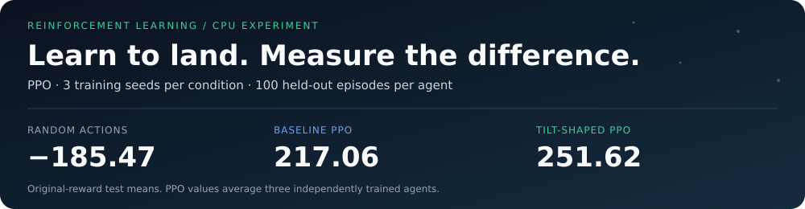
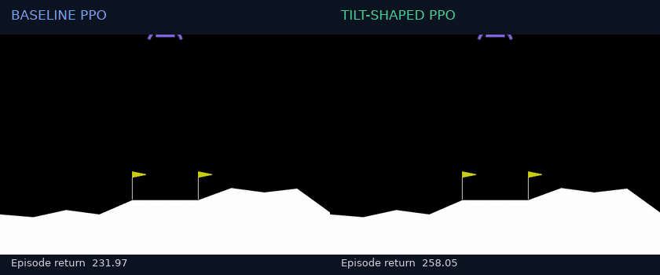
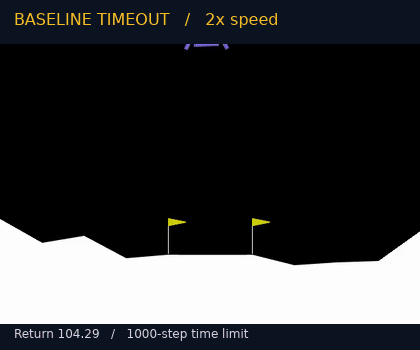
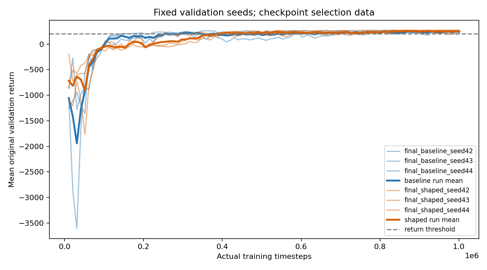
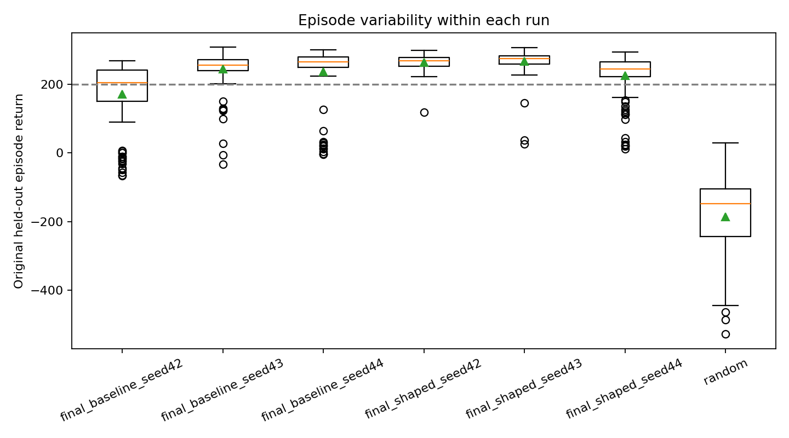
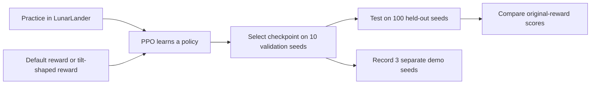

# Lunar Lander PPO



A completed CPU reinforcement-learning experiment for Gymnasium `LunarLander-v3`: train PPO, compare it with random actions, and test potential-based tilt shaping under equal training budgets. The spacecraft has eight observation values and four discrete actions; PPO learns an MLP policy for choosing the engines.

**Result:** across three training seeds, tilt-shaped PPO achieved mean held-out return **251.62**, compared with **217.06** for baseline PPO and **−185.47** for random actions. Shaping improved average final performance by **34.56 points**, but did not improve the predefined learning-speed metric. [Full experiment notes](PROJECT_NOTES.md).

## Watch the agents



**Same scenario, different training feedback.** Left: baseline PPO, episode return **231.97**. Right: tilt-shaped PPO, episode return **258.05**. Both use training seed **42** and demo seed **30,000**, chosen in advance and separate from testing. Playback is at the original speed; the shorter episode holds its final frame. [Static preview](assets/readme/landing-preview.png).

These are real recorded simulator episodes. The full test results below describe reliability across episodes and training seeds.

<details>
<summary>Watch a timeout example</summary>



Baseline PPO, training seed **42**, demo seed **30,002**: return **104.29**, truncated at **1,000 steps**. The full 20-second recording plays at **2× speed** here. This shows a lower-scoring time-limit outcome alongside the comparison above.

</details>

<details>
<summary>Original videos and animation provenance</summary>

- [Baseline PPO, demo seed 30,000](videos/final_baseline_seed42/lander-episode-0.mp4).
- [Tilt-shaped PPO, demo seed 30,000](videos/final_shaped_seed42/lander-episode-0.mp4).
- [Baseline timeout, demo seed 30,002](videos/final_baseline_seed42/lander-episode-2.mp4).

The GIFs and static preview live in `assets/readme/` so they can display directly on GitHub when committed. The full MP4s remain local ignored artifacts. All 18 original production clips have score records and checksum manifests in the [artifact index](results/final/artifacts.json). No external video hosting is configured.

To rebuild the animations from the original videos using FFmpeg, without training or downloads:

```bash
python3 scripts/build_readme_media.py
```

The builder verifies source-video checksums before conversion. [Animation provenance](assets/readme/manifest.json) records source seeds, scores, timing, and output hashes. The two GIFs total about **322 KiB**.

</details>

## Measured results

Each agent trained for **1,001,472 actual timesteps**, then its best validation checkpoint was tested deterministically on the same **100 held-out episode seeds**. All scores use the original simulator reward.

| Condition | Training seed | Mean return ± episode SD | Returns ≥200 | Truncated |
| --- | --- | --- | --- | --- |
| Random actions | — | −185.47 ± 112.51 | 0% | 1% |
| Baseline PPO | 42 | 171.43 ± 95.01 | 54% | 8% |
| Baseline PPO | 43 | 244.23 ± 57.59 | 92% | 5% |
| Baseline PPO | 44 | 235.53 ± 83.93 | 87% | 1% |
| Tilt-shaped PPO | 42 | 263.92 ± 22.79 | 99% | 1% |
| Tilt-shaped PPO | 43 | 266.51 ± 40.51 | 97% | 1% |
| Tilt-shaped PPO | 44 | 224.44 ± 65.67 | 84% | 10% |

Across the three independent runs, mean ± sample SD of run means was **217.06 ± 39.76** for baseline and **251.62 ± 23.58** for shaping. Shaping helped seeds 42 and 43, but hurt seed 44. All three shaped agents and two baseline agents met the project target of mean held-out return ≥200. Threshold attainment is a reward metric; physical landing-success rates were not separately measured.



The learning-speed metric was the first scheduled validation mean ≥200. Baseline versus shaped crossing steps were 256,000 versus 256,000 (seed 42), 296,960 versus 389,120 (43), and 143,360 versus 491,520 (44). Shaping tied or crossed later, despite its better average final test score.



Inspect the [raw episode CSVs and summaries](results/final/), [per-run results](results/final/RESULTS.md), and [run-level aggregate](results/final/aggregate.json). There are three independent training runs per condition, not 300 independent training experiments.

## Setup

The experiment ran in **Ubuntu Distrobox on Arch Linux, Python 3.10.12**, using an Intel i7-13700H with one PyTorch CPU thread. No dedicated GPU was used. Measured versions and all resolved dependencies are recorded in [requirements-lock.txt](requirements-lock.txt) and per-run metadata.

Inside Ubuntu, from this shared project directory:

```bash
python3 -m venv .venv-ubuntu
source .venv-ubuntu/bin/activate
python -m pip install swig
python -m pip install -r requirements-lock.txt
python -m pip check
python -m unittest discover -s tests -v
python smoke_check.py --name reproduce_smoke
```

For an existing installation, activate `.venv-ubuntu` inside the same Ubuntu container. Keep it separate from the Arch-host `.venv`. A compiler and Python development headers may be needed for Box2D; see [GUIDE.md](GUIDE.md).

The smoke command trains both conditions for 10,240 steps, checks deterministic checkpoint reloads, generates plots, and records/decodes a video. Its results are pipeline checks. The original Ubuntu smoke workflow passed; an independent clean-environment reproduction has not been repeated.

The measured lock includes CUDA-related packages installed by the PyTorch distribution, although all model execution uses CPU. Preserve this lock for provenance; a future CPU-only installation can use a different resolved dependency set.

## Reproduce the experiment

Use a fresh experiment name so the existing results stay intact:

```bash
python run_experiments.py --name reproduce
```

This trains both conditions for seeds 42, 43 and 44, each for 1,001,472 steps (489 complete 2,048-step rollouts), evaluates random actions and every selected checkpoint on the fixed 100 held-out seeds, verifies provenance, generates figures/tables, and records three demo episodes per model. The original six runs took **85.62 minutes of summed training time including validation callbacks**, plus held-out evaluation and recording. Runtime varied substantially between runs and depends on host load.

For a smaller exploratory comparison, choose a fresh name and equal rollout-aligned budgets:

```bash
python run_experiments.py --name exploratory --seeds 42 --steps 100352
```

`--resume` skips completed stages only when the frozen protocol and Python source hashes match. Partial training is preserved and rejected; this option does not resume interrupted training.

Inspect existing results or rebuild their plots inside Ubuntu without training again:

```bash
python verify_results.py --results results/final
python plot_results.py --results results/final --logs results/final/training
```

## How the experiment works



Both conditions get the same practice budget. Tilt shaping changes the feedback during training; validation, testing and videos use the original simulator scoring.

## Measurement and shaping

Only the training environment receives the additional potential-based feedback:

```text
Phi(s) = -abs(s[4])
r_train = r_original + alpha * (gamma * Phi(next_s) - Phi(s))
alpha = 1.0; gamma = 0.99
```

True terminal transitions use zero next potential; time-limit truncations retain next-state potential. Validation, testing and demos score original rewards. See [rewards.py](rewards.py).

Checkpoint selection uses deterministic predictions on seeds 10,000–10,009 after every 10,240 training steps and after the final update; highest mean original validation return wins, with the earliest checkpoint winning ties. Testing uses seeds 20,000–20,099; videos use 30,000–30,002. PPO settings, budgets and evaluation opportunities are matched across conditions. The [frozen protocol](results/final/protocol.json) includes the hypothesis and source hashes.

## Artifacts and limitations

| Path | Contents |
| --- | --- |
| `assets/readme/` | Lightweight GIFs, static preview, summary graphic, and animation provenance |
| `results/final/*_episodes.csv` and `.json` | Raw held-out episodes, statistics, checkpoint identity and metadata |
| `results/final/summary.csv`, `aggregate.json`, `RESULTS.md` | Run results and variability |
| `results/final/training/<run>/` | Small validation logs, run metadata, selected checkpoint provenance |
| `results/final/demos/<run>/` | Demo scores and video manifests |
| `results/final/artifacts.json` | Local artifact paths, sizes and SHA-256 hashes |
| `models/<run>/` | Best and final checkpoints, ignored by Git |
| `logs/<run>/` | Original logs and TensorBoard data, ignored by Git |
| `videos/<run>/` | MP4s and manifests, ignored by Git |

The seven-policy comparison passed budget, seed-bank, summary and checkpoint-provenance checks; all 72 indexed artifacts matched their hashes. Root Python source matches the recorded experiment hashes. Small evidence files and figures are ready for source control; large artifacts remain local.

Only three training seeds and ten validation seeds were used. Selecting the best checkpoint on a small validation bank can overfit that bank. These results support an average improvement for this experiment, not a general or statistically established shaping advantage. A simulation benchmark and good-looking clips do not establish real-world control performance or a measured physical landing-success rate.

## References

For local commit preparation, About/topics updates and a later explicit upload, see [GITHUB.md](GITHUB.md). The GitHub helper previews by default and keeps committing, metadata updates and pushing as separate actions.

Implementation follows the [Gymnasium Lunar Lander API](https://gymnasium.farama.org/environments/box2d/lunar_lander/), [Stable-Baselines3 PPO API](https://stable-baselines3.readthedocs.io/en/master/modules/ppo.html), and [Gymnasium recording API](https://gymnasium.farama.org/introduction/record_agent/). Algorithm background: [PPO](https://arxiv.org/abs/1707.06347) and [potential-based reward shaping](https://people.eecs.berkeley.edu/~russell/papers/icml99-shaping.pdf).
